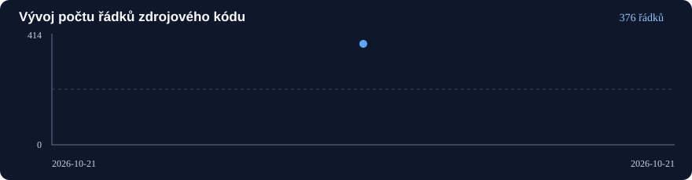

# AirRadar V2

Nová generace leteckého radaru, budovaná **od nuly**. Tento repozitář je zcela oddělený od [AirRadar V1](https://github.com/Boym323/AirRadar). Původní aplikace, produkční LXC a databáze se nemění.

**Stav:** dokončen a ověřen základ G-00; **nejde ještě o živý radar**. G-01 a další etapy zatím nejsou realizovány.

<!-- AIRRADAR_STATS_START -->
## Statistiky vývoje (automaticky aktualizované)

Aktualizace statistik: **denně ve 03:17 (Europe/Prague)** a ručně na vyžádání.

| Ukazatel | Stav |
|---|---:|
| Řádky zdrojového kódu, včetně prázdných | **628** |
| Rust | 149 |
| TypeScript / JavaScript / CSS | 479 |
| Soubory zdrojového kódu | 14 |
| Testovací soubory (ne počet testů) | 2 |
| Dokumenty Markdown | 58 |
| Všechny sledované soubory | 91 |
| Dokončené etapy | **1/14** (7,1 %) |
| Ověřené KEEP funkce | **0/45** (0,0 %) |

Měřený commit: [288a2020](https://github.com/Boym323/AirRadarV2/commit/288a2020f0535a452ae191751af360b9fce50ba7) · [Historie](docs/metrics/history.json) · [Metodika](docs/metrics/README.md) · [Výsledky CI](https://github.com/Boym323/AirRadarV2/actions/workflows/ci.yml).

> Jde o vývojové statistiky repozitáře, nikoli o výkon živého radaru. Funkce se počítají jen ze strojové matice s důkazem testu. Úspěšná CI sama o sobě nedokazuje dokončení funkcí.
<!-- AIRRADAR_STATS_END -->

## Česká zadání a vývoj

| Soubor | Účel |
|---|---|
| [Závazné zadání](docs/plan/ZADANI-AIRRADAR-V2.md) | Architektura místního radaru a provozní invarianty |
| **[Technologický průzkum](docs/plan/TECHNOLOGICKY-PRUZKUM.md)** | Ověřené zdroje a odpovědi na výběr jazyků, webu, DB, streamu a LXC |
| [Cílová architektura](docs/plan/ARCHITEKTURA-V2.md) | Doporučený Rust engine + lehký statický web a DB brána |
| [Technologická rozhodnutí](docs/plan/TECHNOLOGICKA-ROZHODNUTI.md) | Co zachovat, co doporučit změnit a co ještě vyžaduje benchmark |
| [Benchmarkový plán](docs/plan/BENCHMARKY-TECHNOLOGII.md) | Reprodukovatelná měření B01–B07; výsledky zatím nemáme |
| [Aktivní matice 45 funkcí](docs/plan/MATICE-FUNKCI.md) | Jediný zdroj požadavků k implementaci |
| [Katalog modulů](docs/plan/MODULY-A-ROZSAH.md) | Vlastnictví funkcí v 9 modulech |
| [Podrobné popisy](docs/plan/PODROBNY-KATALOG-FUNKCI.md) | Co každá aktivní funkce skutečně dělá |
| [Etapy a stav](docs/plan/ETAPY-A-STAV.md) | 14 navazujících etap G-00 až G-13 |
| **[140 konkrétních implementačních kroků](docs/plan/KROKOVY-IMPLEMENTACNI-PLAN.md)** | Detailní návaznosti, testovací brány a odkazy na G-01 až G-13 |
| [Začít v novém vlákně](docs/plan/ZACNI-ZDE-NOVE-VLAKNO.md) | Kontext projektu a práce s Markdown dokumenty |
| [Pravidla pro Codex](AGENTS.md) | Čeština, izolace, testy a evidence |
| [CHANGELOG](CHANGELOG.md) | Změny a důkazy v historii projektu |
| [Archiv budoucích rozšíření](docs/backlog/FUNKCE-PRO-BUDOUCI-ROZSIRENI.md) | Oddělená evidence případných nových funkcí |

## Aktuální architektura a navržené změny

- **Rust/Tokio/Axum:** readsb JSON a BEAST TCP, vlastní RAM letadel, bezpečné REST API a SSE.
- **Vite/React/MapLibre:** lehká česká mapa, seznam letadel, popisky, stopa a follow.
- **PostgreSQL/SQLx:** samostatná V2 databáze na existujícím odděleném DB LXC; historie V1 se nepřenáší.
- **Jedno místní pokrytí:** uživatel pracuje vždy s daty místního přijímače, bez přepínače datových zdrojů.
- **45 schválených funkcí:** žádná z nich zatím není potvrzena jako implementovaná. G-00 je pouze základ projektu.

**Zvoleno a implementováno:** Vite + React/TypeScript pro webový skeleton. **PostgreSQL/SQLx** na existujícím samostatném DB LXC jako definitivní databáze; V2 DB ani migrace ještě nevznikly. Viz [ADR 0005](docs/adr/0005-vite-a-postgresql-v2.md).

API nyní vrací zkušební `NOT_IMPLEMENTED`. Nejsou zatím připojena živá ADS-B data, databáze ani veřejný release.

## Lokální vývoj

Vyžaduje Rust stable, **Node.js 26.12.0 a npm 11.20.0**. Soubor `.node-version` sjednocuje lokální vývoj a GitHub CI. Nepoužívej produkční checkout AirRadar V1.

~~~bash
cargo run --locked -p airradarv2-engine
# http://127.0.0.1:4101/api/v1/health

cd apps/web
npm ci
npm run dev
# http://127.0.0.1:4100
~~~

## Kontroly

~~~bash
cargo fmt --all -- --check
cargo clippy --locked --workspace --all-targets -- -D warnings
cargo test --locked --workspace
node tools/check-docs.mjs
cd apps/web
npm ci
npm run lint
npm run typecheck
npm test
npm run build
~~~

Pro vývoj je nyní schváleno **45 aktivních funkcí**. Žádný produkční modul ještě není implementován. Závislosti jsou připnuté v `Cargo.lock` a `apps/web/package-lock.json`. [CI běh 39659205202](https://github.com/Boym323/AirRadarV2/actions/runs/39659205202) ověřil na commitu `99df0456` Rust, Vite a HTTP smoke testy; podrobný [report](docs/reports/G-00-BOOTSTRAP.md). Pozdější změny dokumentace a českého úvodu se ověřují samostatným CI.

**Není nakonfigurováno žádné produkční nasazení.** Samostatný LXC zajistí vlastník projektu; V1 zůstává dostupná pro srovnávání.

## PostgreSQL a statický provoz

PostgreSQL v existujícím separátním LXC potřebuje vlastní databázi/role a bezpečně omezený síťový přístup: [postup](database/POSTGRES-LXC.md). Žádná DB nebyla v této etapě změněna. Vite produkuje `apps/web/dist/`, který bude v produkci poskytovat reverse proxy bez Node serveru; `npm run preview` je pouze kontrola buildu.

## Konkretizace technologií před implementací (22. 10. 2026)

[**Přesné technické kontrakty pro 6 oblastí**](docs/plan/TECHNICKE-KONTRAKTY-A-LIMITY.md) sjednocují PostgreSQL schéma/indexy/retenci/zálohy, readsb/BEAST a deduplikaci, SSE a limity paměti, výkonnost MapLibre, Playwright testy a bezpečné spojení LXC. Český [ADR 0006](docs/adr/0006-kontrakty-dat-streamu-mapy-a-lxc.md) je výchozím rozhodnutím. Parametry jsou **návrhem k měření, nikoli implementovaným produkčním řešením**.

## Optimalizace CPU, RAM a diskových zápisů — 22. 10. 2026

**Nově zvolená politika:** [deduplikace už v Rust RAM](docs/technical/RAM-CACHE-A-DEDUP-ZAPISU.md), adaptivní uložení běžných pohybujících se letadel **nejdříve po 60 s**, výjimka významný manévr nejdříve po 30 s, 30s UTC SQL deduplikační bucket, nejvýše 128 řádků v batch či 5s flush po uzavření bucketu. Živá mapa a 1Hz SSE čtou RAM bez DB dotazu na každý event.

[Revidovaný fyzický model PostgreSQL](database/POSTGRES-DATOVY-MODEL.md) nezařazuje další indexy ani partitioning bez reálného měření. [ADR 0007](docs/adr/0007-ram-first-deduplikace-a-usporny-zapis.md) vysvětluje změnu proti pevné 15s historii. **Jde o implementační návrh, nikoli již dosaženou úsporu diskových IOPS.**

## Architektonický audit před implementací

[**Audit 22. 10. 2026 — uzavřená rozhodnutí a zbývající rizika**](docs/audits/ARCHITEKTONICKY-AUDIT-AIRRADAR-V2-2026-10-22.md) potvrzuje stabilní stack Rust/Vite/PostgreSQL, ale dokumentuje otevřené kontrakty časových značek, integrity pozorování, SSE atomického snapshotu, logbooku, notifikačních oprávnění a skutečné DB infrastruktury. **G-01 lze zahájit; jeho převzetí vyžaduje tři blokující kontraktové testy.** Zelené G-00 CI není potvrzení implementace 45 funkcí.

## Dokončená G-01: datové kontrakty

Dne 22. 10. 2026 byla dokončena **G-01**: [report](docs/reports/G-01-VYSLEDEK.md), [CI 39748325104](https://github.com/Boym323/AirRadarV2/actions/runs/39748325104) (Rust, web i nezávislý OpenAPI/JSON Schema validátor PASS). Následuje G-02 ingest. Kontrakty jsou hotové, **živý radar, PostgreSQL připojení ani produkční release nejsou**.

## Samostatný DEV LXC — připravený první ruční deploy

Po G-01 je ověřen samostatný Debian 13.7 LXC (1 vCPU, 8 GiB RAM, 20 GiB disk). [První nasazení krok za krokem](docs/runbooks/DEV-LXC-PRVNI-NASAZENI.md) používá **ruční GitHub Actions artefakt**, SHA-256 a oddělený systemd + Nginx na privátní IPv4. **Žádný auto-deploy ani spojení s V1, DB či readsb.**

## Skutečně instalovaný DEV základ

Správce dne 22. 10. 2026 doložil první úspěšné **ruční DEV LXC nasazení** commitu `227a8619b590d2c536761ffefc75cd0a5633936c`. Integrita balíčku OK, systemd Rust/Nginx active, health `bootstrap`, API letadel `NOT_IMPLEMENTED`; [přejímací report](docs/reports/DEV-LXC-PRVNI-NASAZENI-2026-10-22.md). Jde výhradně o G-00/G-01 základ, ne živý radar ani produkční release.

## První testovaná implementace G-02

[Průběžný report](docs/reports/G-02-VYSLEDEK.md) a [CI 39762483657](https://github.com/Boym323/AirRadarV2/actions/runs/39762483657): lokální JSON/BEAST, DF17/CPR, RAM a bounded supervisor, offline syntetický replay; **G-02 je ROZPRACOVÁNO**, zbývají metadata, širší dekódování a výkonnostní prověrky. Záměrně **není nasazeno do DEV LXC**, G-00/G-01 verze zůstává funkční.

## Rozšířená G-02 implementace (22. 10. 2026)

[CI #39769323592](https://github.com/Boym323/AirRadarV2/actions/runs/39769323592): 26 Rust testů, 3/3 joby PASS. DF17/CPR, letová telemetrie readsb/TC19, jeden RAM stav, JSON+BEAST replay, 5 000 cílů syntetický 1×/2×/4× benchmark. V matici je šest M01 funkcí `TESTED`. **G-02 = 10/11 kroků, zbývá povinná G-02.11 přejímka přímo na DEV LXC.** G-02 stále není nasazena do DEV a veřejný G-00/G-01 web není živý radar. [Report](docs/reports/G-02-VYSLEDEK.md).
